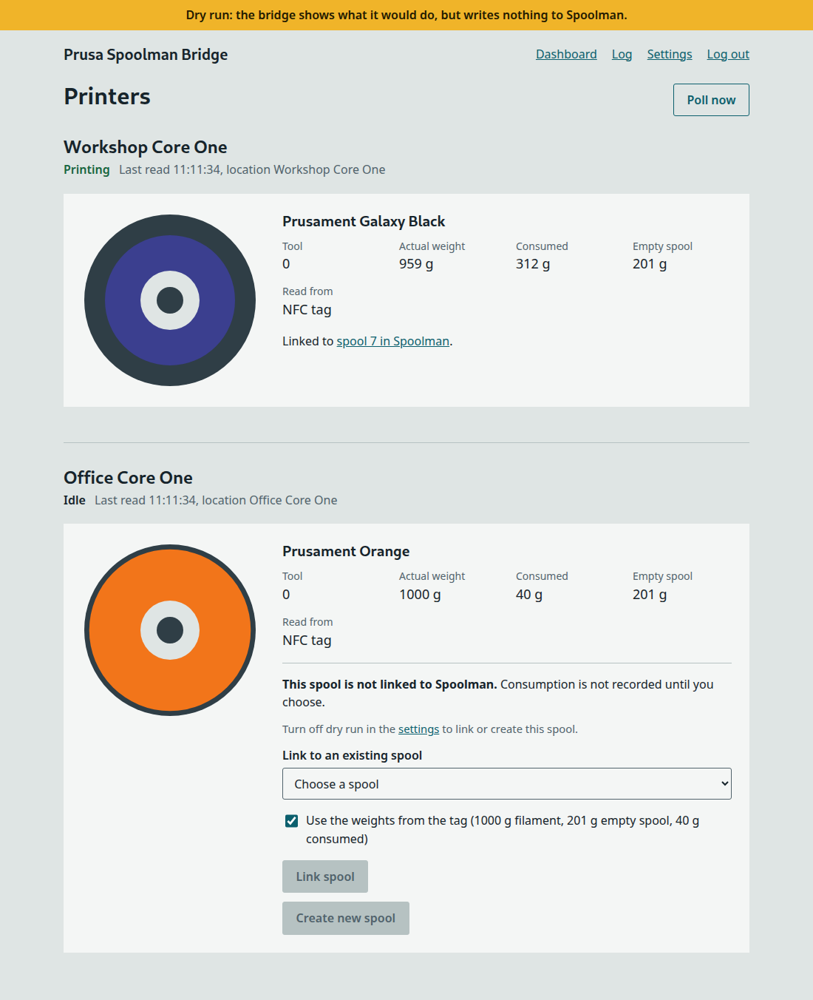
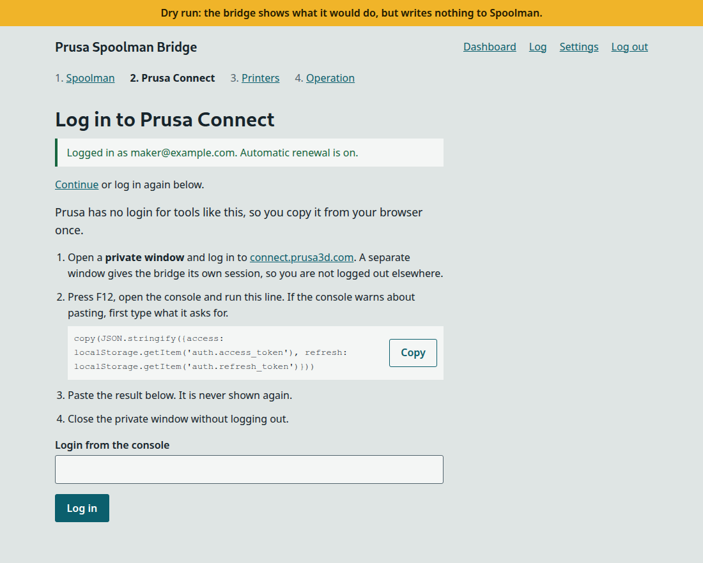
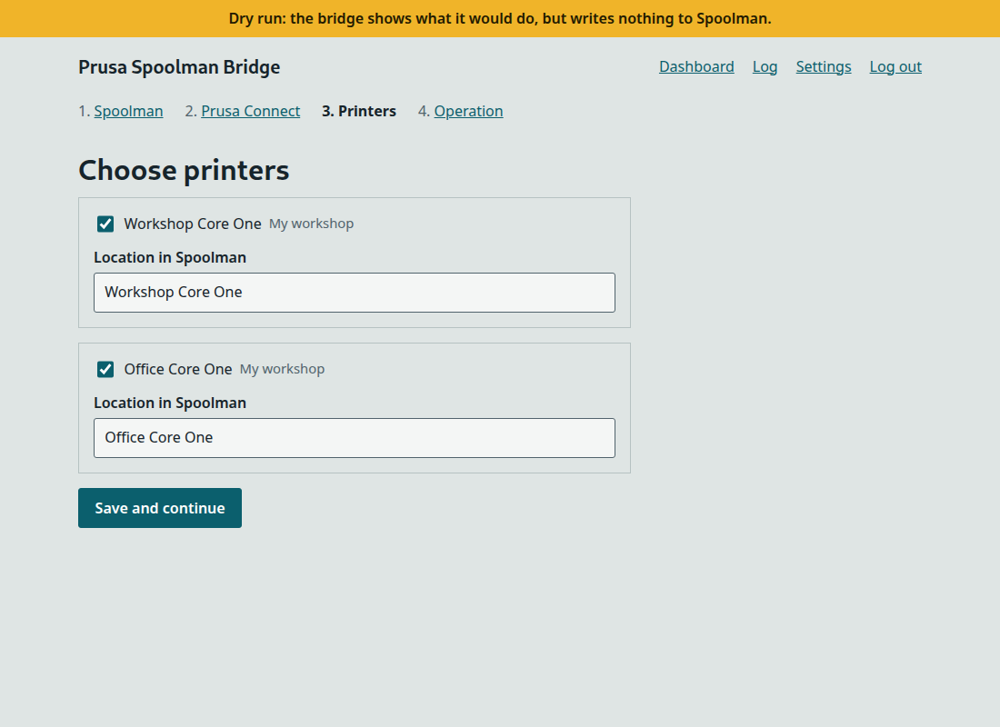
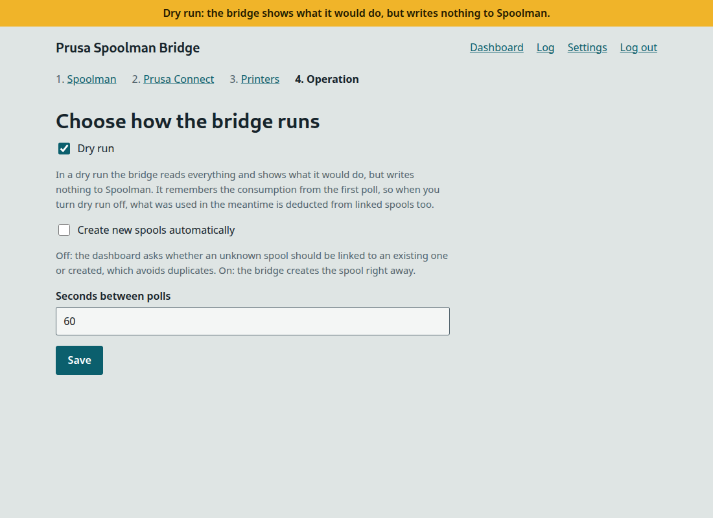
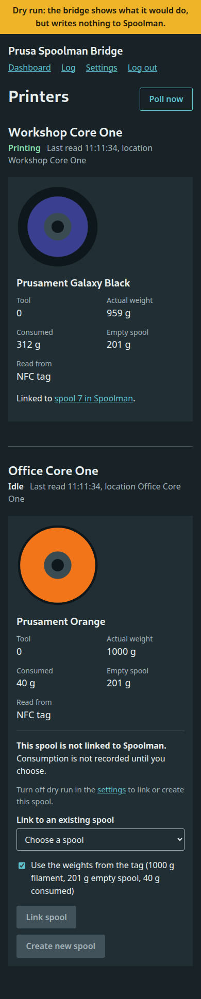

# OpenPrintTag Spoolman

[](https://github.com/mathiasbk/openprinttag-spoolman/actions/workflows/tests.yml)

Keeps [Spoolman](https://github.com/Donkie/Spoolman) up to date with the spools loaded in your Prusa printers. The bridge reads each loaded spool's OpenPrintTag data from Prusa Connect, links it to a Spoolman spool and records what the printer consumes.

**This is an unofficial project, not affiliated with Prusa Research or Spoolman.** It uses the same undocumented API as the Prusa Connect web app, which can change or stop working at any time.



## How it works

1. Every minute, the bridge asks Prusa Connect's GraphQL API what each printer has loaded. Connect reports the OpenPrintTag data read from the spool's NFC tag, including its instance UUID.
2. It looks that UUID up in the `opt_instance_uuid` extra field in Spoolman. You choose what happens to a spool it does not know: link it to an existing one, or create a new one.
3. When Connect reports higher consumption for a linked spool, the bridge deducts the difference in Spoolman.

The bridge starts in dry-run mode. It reads everything and shows what it would do, but writes nothing to Spoolman until you turn that off.

## Requirements

- A Prusa printer with an OpenPrintTag NFC reader, connected to a Prusa Connect account. Tested with a Core One on firmware 8.0.0.
- Spools with OpenPrintTag NFC tags.
- A running [Spoolman](https://github.com/Donkie/Spoolman) server. Tested with version 0.27.0.
- Docker with Compose 2.24 or newer.

## Quick start

```
git clone https://github.com/mathiasbk/openprinttag-spoolman.git
cd openprinttag-spoolman
docker compose up -d --build
```

Open `http://your-server:7913` and follow the steps:

1. **Password:** choose an admin password. Do this right away, because whoever opens the page first sets it.
2. **Spoolman:** enter the address and test the connection. If you use HTTPS with your own CA, upload the root certificate here.
3. **Prusa Connect:** log in using a private window, run the line the page shows in the browser console, and paste the result. Prusa has no login for tools like this, so you copy it from your browser once. The bridge renews it after that.
4. **Printers:** choose your printers and the location each one gets in Spoolman.
5. **Operation:** choose dry run, whether new spools are created automatically, and how often to poll.

Watch your first print in dry-run mode, then turn dry run off in the settings once the consumption looks right.

## Linking spools

If the bridge does not know a loaded spool, the dashboard asks you to choose. Both choices need dry run to be off, because a dry run never writes to Spoolman.

- **Link to an existing spool:** the list suggests spools from the same vendor first. You can choose to use the weights from the tag. Other extra fields are kept.
- **Create a new spool:** the bridge finds or creates the vendor and filament, then creates the spool with the weights from the tag.

Set `AUTO_CREATE` or turn it on in the settings to create unknown spools without asking.

## Consumption

| Consumption from Connect | What the bridge does |
|---|---|
| First time a linked spool is seen | Stores the value as a baseline and deducts nothing |
| Higher than last time | Deducts the difference with `PUT /api/v1/spool/{id}/use` |
| Lower than last time | Stores the new value and logs a warning |

`data/state.json` is updated only after Spoolman has answered. A dry run stores only its first baseline, so what is used during the dry run is deducted when you turn writing on.

## Configuration

Everything can be set in the browser and is saved in `data/config.json`. Environment variables and `.env` are defaults for anything not saved there. See `.env.example`.

| Variable | Default | Meaning |
|---|---|---|
| `WEB_PORT` | `7913` | Port of the web interface |
| `PUID`, `PGID` | `1000` | User that owns `data/` |
| `SPOOLMAN_URL` | None | Spoolman address |
| `SPOOLMAN_CA_BUNDLE` | System CAs | Root certificate for HTTPS |
| `SPOOLMAN_VERIFY_TLS` | `true` | `false` turns off the certificate check |
| `CONNECT_PRINTER_UUID`, `CONNECT_ORGANIZATION_ID` | None | One printer, if you do not choose in the browser |
| `LOCATION_NAME` | `Core One` | Location for the printer above |
| `POLL_INTERVAL` | `60` | Seconds between polls |
| `DRY_RUN` | `true` | Dry-run mode |
| `AUTO_CREATE` | `false` | Create unknown spools without asking |

## Security

- **Your Prusa account:** `data/` holds a login that gives access to your Prusa Connect account. Files with secrets have mode `600` and are never shown in the browser. Keep the folder private.
- **Plain HTTP:** the password and login travel unencrypted over your network. Use the bridge only on a network you trust, or put it behind a reverse proxy with HTTPS. Do not expose it to the internet.
- **First visitor:** whoever opens the page first chooses the password.
- **Forgotten password:** stop the bridge, delete `data/auth.json` and start it again.

## Limitations

- **Consumption is not fully verified:** Connect has been seen updating `consumedWeight` during a print, but the totals have not been checked against a finished print.
- **Token renewal is not verified against Prusa:** it follows the web app's code. If renewal is rejected, the dashboard says so and you need to log in again.
- **NFC only:** spools not read from an NFC tag are not tracked.

## Screenshots

| | |
|---|---|
|  |  |
|  |  |

## Development

```
python -m venv .venv
.venv/bin/pip install -r requirements-dev.txt
.venv/bin/python -m pytest
```

`python -m bridge once` runs one poll and exits. `python -m bridge bootstrap` stores the login from the terminal.

## License

[MIT](LICENSE)
